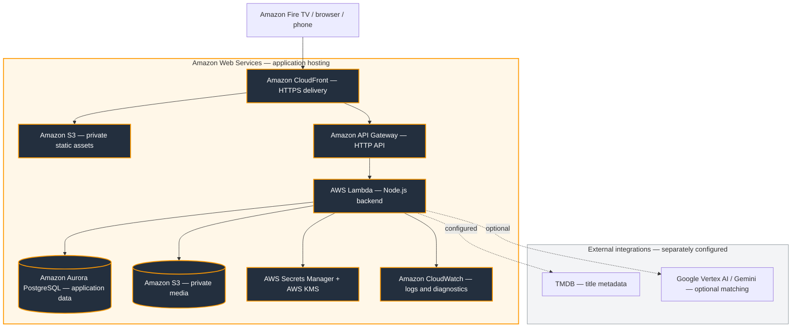

<div align="center">


# Crave Frame

### Make a little time for each other.

A shared evening, from the first choice to the moment you keep. Choose dinner and a story on TV, cook together with your phones, and save a little of tonight.

[Explore the AWS demo](https://dcp5jtiiw3gji.cloudfront.net/tv/) · [Architecture](docs/ARCHITECTURE.md) · [Setup](docs/SETUP.md) · [Friction log](docs/FRICTION-LOG.md)


</div>

---

## Why Crave Frame?

“What should we eat?” and “What should we watch?” can consume the evening before it starts. Crave Frame brings those decisions together: a title, a dinner, an explanation of the pairing, and a plan you can follow.

The television is the shared place to choose. The phone becomes the cooking companion. When dinner runs late, the evening can change with it.

## From choosing to cooking

| Step | Your action | The experience |
| --- | --- | --- |
| **Discover** | Start with a title or a meal | Explained dinner-and-show suggestions |
| **Agree** | Compare choices together | Household food, time, effort and family preferences |
| **Plan** | Review and save an evening | Ingredients, portions and a schedule |
| **Cook** | Open the scoped phone handoff | Steps, timers and synchronized progress |
| **Adapt** | Report a delay or change dinner | A proposed revision to review before applying |
| **Remember** | Rate the evening | Saved nights and explicit taste feedback |

## Built around a night at home

- **TV controls:** directional focus, Back navigation and scrolling assistance.
- **Pairings with explanations:** documented food connections, setting interpretations and practical choices are distinguished.
- **Shared decisions:** household planning and a shared reveal.
- **Guidance for different cooks:** portions, cooking-level instructions and kid-oriented guidance with parent controls.
- **Phone handoff:** a scoped link carries cooking away from the television.
- **Flexible plans:** delays, simpler dinners and external order-out alternatives.

This is a hackathon prototype. It does not stream films, place orders, track deliveries or integrate with Alexa. Streaming and delivery services open through external handoffs; delivery estimates come from the user.

## Tonight’s Edition

After viewing begins and dinner is ready, open the optional keepsake on your saved evening or phone companion. Each person submits a moment (up to 280 characters) or skips. Answers are shared household data when submitted; the UI reveals the complete card once both have responded. This is not a secret-message system.

The TV offers an editable title, explicit private saving to the existing collection, and a way to plan another evening. If the existing card is already shared publicly, stop sharing before saving the personal edition. Saved cards are snapshots; later answers do not silently rewrite them. No relationship score, streak, or pressure to participate.

## A more personal night for two

The TV/phone experience in the current source includes:

- **Two cooking roles:** Each person keeps a stable partner number and independently chooses cooking or preparation for tonight. Swapping jobs does not switch feedback identity. Independent preparation checks sync across phones without advancing the recipe. Cooking steps retain their original order and time estimates.
- **Evidence labels:** documented food connections, story interpretations, setting interpretations, and mood/pace matches have distinct labels. Documented connections offer a reference link.
- **Quick changes:** “Too much cooking,” “Different food,” and “We’re running late” use existing review and scheduling flows. Dinner changes retain the selected title and restrictions; a recipe cannot be replaced after cooking begins.
- **Two-person feedback:** each partner can save dinner feedback first, then rate viewing after starting the viewing timer. The most recently edited answer takes precedence, even when it belongs to an older evening. Our Night In respects either partner’s skips, favors positive responses, and prefers dinners outside the last three saved evenings when suitable alternatives exist. Feedback can be removed from its saved evening.
- **Shared reveal:** both screens show the top-voted dinner and title, with cook/dinner/watch estimates. Ties are labeled, no choice is saved automatically, and the brief animation is skippable and respects reduced motion.

Partner numbers are shared household profiles, separate from kitchen jobs, not authenticated personal accounts. Keep the same number across evenings. Anyone with the private cooking link can update its evening, including role tasks and feedback; the existing link expiration and revocation still apply. The original browser planner shares the matching model and backend, while these interaction panels live in the TV/phone experience at /tv/.

## Matching, with or without live AI

**Catalog mode** applies deterministic preferences and restrictions to recipe/title candidates. **Connected AI mode** adds Gemini selection and explanations through Vertex AI when configured. TMDB discovery is a separate integration requiring its own token.

The model selects eligible candidates rather than inventing arbitrary recipes. Returned IDs, timing and supporting excerpts are checked. Unsupported connections fall back to practical explanations. These checks do not guarantee every interpretation or make recipes allergy-certified.

[AI design](docs/AI.md) · [Recorded evaluation](docs/AI-EVALUATION.md) · [Asset provenance](docs/ASSETS.md)

## Built on Amazon Web Services



**Amazon CloudFront delivers the app; Amazon API Gateway and AWS Lambda run the API; Amazon Aurora PostgreSQL stores application data; Amazon S3 stores assets and private media.** AWS Secrets Manager, AWS KMS and Amazon CloudWatch support runtime security and diagnostics.

The AWS adapter reuses application routes and product logic. The full CDK design adds RDS Proxy, WAF and multi-AZ networking; the existing deployment has a separate configuration and repair history. This is a component overview, not a fresh inventory of deployed resources.

Local development uses SQLite. The retained Cloudflare runtime uses D1/R2. These environments have separate data stores; publishing code does not migrate data or deploy a release.

[Detailed architecture](docs/ARCHITECTURE.md) · [AWS deployment and rollback](docs/AWS-DEPLOYMENT.md) · [Security boundaries](docs/SECURITY.md)

## Run locally

Requires **Node.js 24+**, npm and Git. Windows PowerShell is supported.

```sh
git clone https://github.com/sagitta414/crave-frame.git
cd crave-frame
npm run setup
npm run build
npm run dev
```

| Surface | Address |
| --- | --- |
| TV / responsive app | http://127.0.0.1:4178/tv/ |
| Browser planner | http://127.0.0.1:4178/app/ |

Catalog planning works without provider credentials. Live AI and TMDB need configuration. A phone needs a backend it can reach; its own localhost is not your computer. Never commit credentials.

[Configuration guide](docs/SETUP.md) · [Fire TV installation](docs/FIRE-TV-INSTALL.md)

## Quality and release status

**Updated 22 October 2026.** The local remediation workspace passed **211 web + 55 TV + 10 AWS tests**, TV type checking, remote/paging checks, a production build and the configured secret-pattern scan. The application repairs are included in this source update, and the checks were rerun before publication to main. These results do not establish that the live demo has been updated.

```sh
npm test
npm --prefix aws test
npm run check:secrets
npm run build
```

| Evidence | What it establishes |
| --- | --- |
| Automated regressions | Checked scheduling, request races, capability state and navigation cases |
| Build/type checks | The local source compiles and exports |
| Friction log | Observed failures, impact, remediation and acceptance work |
| Physical-device acceptance | Still required for the latest changes |
| Production release | Must be verified separately against its deployment version |

Interactive local browser review was blocked by tooling policy during the latest pass. Couch-distance readability, physical remote navigation and a real two-device reconnect remain open. Photo-access revocation and secret-scanning improvements are recorded in the [security remediation notes](docs/SECURITY-FIXES-2026-10-22.md). Two upstream TV dependency advisories now have [tested temporary local mitigations](docs/TV-SECURITY-PATCHES.md), expiring November 5; official patched releases and provider token rotation remain outstanding. Passing tests is not a security certification.

[Testing guide](docs/TESTING.md) · [Detailed friction log](docs/FRICTION-LOG.md)

## Repository guide

```text
tv/                  Expo / React Native TV app and Android project
web/product/         Browser planner, companion, recipes and planning logic
web/server/          API, authorization, matching and integrations
web/drizzle/         SQLite / D1 migrations
aws/infrastructure/  CDK infrastructure
aws/runtime/         Lambda, PostgreSQL and private-media adapters
aws/migrations/      PostgreSQL migrations
aws/scripts/         Build, deployment, migration and smoke checks
docs/                Architecture, setup, reviews and demo materials
.github/workflows/   Repository validation
```

Some catalog logic is copied between web and TV. Keep both copies aligned when editing; a shared package is a future maintenance improvement.

## Demo and project materials

[Demo guide](docs/DEMO.md) · [Submission checklist](docs/SUBMISSION.md) · [Development friction](docs/FRICTION-LOG.md) · [Tool feedback](docs/TOOL-FEEDBACK.md)

A useful demo follows one complete evening: choose together, inspect the pairing, save dinner, open the phone companion, then apply a delay and compare the schedule. A public repository is not evidence of a completed submission.

## Contributing, security and license

Read [CONTRIBUTING.md](CONTRIBUTING.md) before changing shared logic and [SECURITY.md](SECURITY.md) for reporting guidance. Recipes are prototype content, not professionally kitchen-tested. Generated food imagery is illustrative; third-party imagery and marks retain their terms.

Project-authored source is available under the [MIT License](LICENSE). See [asset provenance](docs/ASSETS.md) for artwork details and exclusions.
