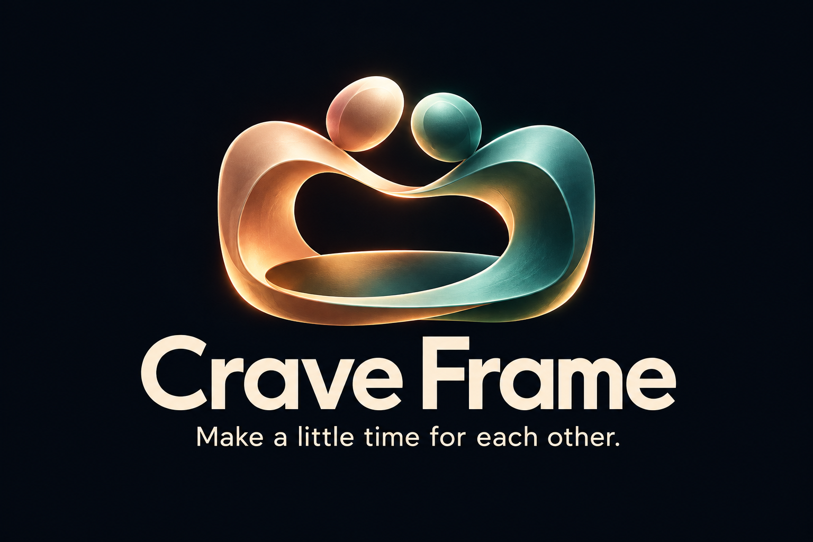
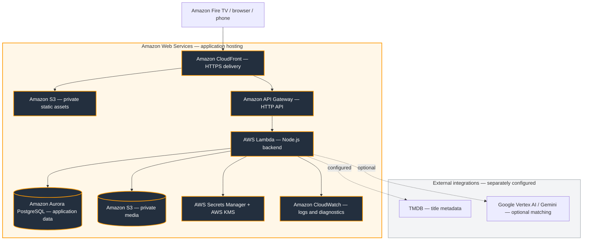

<div align="center">


# Crave Frame

### Make a little time for each other.

A shared evening, from the first choice to the moment you keep. Choose dinner and a story on TV, cook together with your phones, and save a little of tonight.

[Explore the AWS demo](https://dcp5jtiiw3gji.cloudfront.net/tv/) · [Architecture](docs/ARCHITECTURE.md) · [Setup](docs/SETUP.md) · [Friction log](docs/FRICTION-LOG.md)

[](https://github.com/sagitta414/crave-frame/actions/workflows/ci.yml)


</div>

---

## Why I made Crave Frame

I started with what sounded like a fun idea: pick a movie or a show, and find a dinner to go with it. I was building for a Fire TV hackathon, and I liked the possibility of making dinner and watching something feel like one evening instead of two separate decisions.

Then I opened it on my own TV.

From the couch, I couldn’t read parts of it. The logo was too small. Scrolling with the remote was frustrating. I would choose something different to watch and still get dinners that felt much the same. Some recipes were more unusual than I wanted for an ordinary night at home. I kept taking pictures of the screen and going back to fix things. Seeing it on a laptop hadn’t told me what it felt like to use it in the living room.

That changed the question I was asking. I still wanted it to look impressive, but I started asking whether I would actually use it once the hackathon was over.

I wanted a reason to open it with someone. Something that could help us agree on dinner and a movie without turning the evening into another project. Familiar food. A choice that feels like it belongs to both people. Instructions that help a less confident cook join in. And some room for dinner to run late without feeling like the whole plan has gone wrong.

As I kept building, the time together became the part I cared about most. Choosing on the TV gives you a shared place to start. Taking the recipe to your phone means you can leave the couch and get cooking. Splitting the kitchen jobs gives both people a part in making the evening happen. Keeping a little memory afterwards is there if you want it; it doesn’t have to become another thing to complete.

There have been plenty of bugs and revisions along the way. I’m still working on it. But the reason to keep going is clearer now: I want Crave Frame to help turn “What do you want to do tonight?” into something you actually do together.

It doesn’t need to be a special occasion. Dinner at home and a good movie can be enough of a reason to make time for each other.

## What’s new

- **Personal evenings with clear reasons:** recommendations can explain a matching cooking limit, saved ingredient exclusions, or an explicitly saved favorite.
- **Easier dinner, same evening:** preview a lower-effort meal while keeping the title and servings, then review ingredients before approving.
- **Return to a loved evening:** keep dinner and find a new story, find a similar evening, or repeat the pairing. Saved planning settings are reused while current food preferences and exclusions still apply.

The latest source update brings the dinner-and-viewing experience into a warmer, more focused design:

| Update | What changed |
| --- | --- |
| **Together identity** | A sculptural gold-and-teal logo, coordinated navigation and couples panels, and the tagline “Make a little time for each other.” |
| **Clearer first screen** | One featured evening leads. The introduction explains choosing on TV, cooking with a phone, and adjusting when dinner runs late. |
| **Quieter discovery** | Two dinner-focused previews follow the first recommendation shelf. Shared voting, personal touches, and Our Night In are available through Explore more. |
| **Compact navigation** | Narrow screens use a smaller logo, omit the tagline, and place the four destinations in one row below the brand. Content buttons can wrap to fit their available space. |
| **Deeper pairing coverage** | 30 editorial pairings provide at least three dinner choices for each built-in real title. Eligible signature pairings receive extra priority; imported titles can use genre-based ranking and practical explanations. Interpretations are distinguished from documented food connections, and food and time limits still apply. |
| **Simpler couples planning** | Choose an evening and go directly to ingredient review. The preview and dinner alternatives are optional. |
| **Phone delivery updates** | Enter the provider’s remaining estimate from 1–120 minutes on the phone. Successful saves update the shared schedule, close the editor, and show confirmation. Confirm delivery arrival and viewing from the same phone screen, then optionally save a shared memory. Crave Frame does not receive live delivery tracking. |
| **Phone memory saving** | Name and privately save Tonight’s Edition on the phone or TV. Reopening restores the saved title and confirmation; deliberate edits use “Update saved memory.” A failed lookup offers retry instead of presenting a blank card. Only open, eligible cards refresh periodically; they preserve typed titles, and require review when another screen changes the saved version. Stale revisions and changed partner answers are rejected before saving. Deleted editions can be explicitly recreated with fresh sharing and editor access; previous links remain revoked. The cooking link can save only its own evening’s edition. |
| **A shared evening** | Separate cooking roles, partner feedback, reviewed dinner changes, a shared reveal, and the optional Tonight’s Edition keepsake. |

These changes are in the repository. **The AWS demo requires a separate deployment**; the demo link alone does not prove it is running this revision.

## One evening first

The main journey is **choose an evening → check ingredients → cook → watch**. Start with the featured pairing or search for something you already have in mind. Review the ingredients and save the plan, then cook on the TV or take the steps to your phone. When you’re ready to watch, open your streaming service.

You do not need to join a voting room, build a pantry list, choose cooking roles, or save a memory to complete an evening. Those tools are optional. The home screen leads with the featured pairing and recommendations; additional ideas sit below the first shelf, with more behind **Explore more**.

| Core step | Your action | The experience |
| --- | --- | --- |
| **Choose** | Pick a dinner and title | An explanation of the pairing, within your preferences |
| **Check** | Review ingredients and portions, then save | A recipe and shared evening schedule |
| **Cook** | Follow the steps on TV or phone | Cooking guidance, timers and synchronized progress |
| **Watch** | Open your streaming service | Settle in with the title you chose |

## Help when you want it

| Step | Your action | The experience |
| --- | --- | --- |
| **Choose together** | Invite another person to vote | A shared shortlist and optional reveal |
| **Use what you have** | Enter a few pantry ingredients | Suggestions that consider your kitchen |
| **Adapt** | Report a delay or change dinner | A proposed revision to review before applying |
| **Order out** | Finish checkout with a delivery provider | A shared schedule based on the estimate you enter |
| **Remember** | Rate dinner and viewing separately; optionally keep a moment | Partner feedback and a privately saved Tonight’s Edition card |

Kids Kitchen is a separate parent-controlled experience. Collections and personal touches are available for evenings when you want them; they are not steps to finish before dinner.

## Built around a night at home

- **TV controls:** directional focus, Back navigation and scrolling assistance.
- **Pairings with explanations:** documented food connections, setting interpretations and practical choices are distinguished.
- **Shared decisions:** household planning and a shared reveal.
- **Guidance for different cooks:** portions, cooking-level instructions and kid-oriented guidance with parent controls.
- **Phone handoff:** a scoped link carries cooking away from the television.
- **Flexible plans:** delays, simpler dinners and external order-out alternatives.

This is a hackathon prototype. It does not stream films, place orders, track deliveries or integrate with Alexa. Streaming and delivery services open through external handoffs; delivery estimates come from the user.

## Tonight’s Edition

After viewing begins and dinner is ready, open the optional keepsake on your saved evening or phone companion. Each person submits a moment (up to 280 characters) or skips. Answers are shared household data when submitted; the UI reveals the complete card once both have responded. This is not a secret-message system.

Both the phone companion and TV offer an editable title and explicit private saving. You can finish the keepsake on your phone without returning to the TV. After a successful save, the action shows **Saved privately ✓** and stays disabled until the title or submitted answers change. Takeout evenings can confirm dinner arrival and viewing on the same phone before opening the optional memory panel. Reopened editions load their saved title and status, and changed titles or answers can be explicitly saved again. The phone cooking link is limited to reading and saving its own evening’s edition; it does not grant access to other collections.

If the existing card is already shared publicly, stop sharing before saving the personal edition. Saved cards are snapshots; later answers do not silently rewrite them. The TV also offers a way to plan another evening. No relationship score, streak, or pressure to participate.

## A more personal night for two

The TV/phone experience in the current source includes:

- **Two cooking roles:** Each person chooses a partner number for the evening and independently chooses cooking or preparation. Swapping jobs does not switch feedback identity. Independent preparation checks sync across phones without advancing the recipe. Cooking steps retain their original order and time estimates.
- **Evidence labels:** documented food connections, story interpretations, setting interpretations, and mood/pace matches have distinct labels. Documented connections offer a reference link.
- **Quick changes:** “Too much cooking,” “Different food,” and “We’re running late” use existing review and scheduling flows. Dinner changes retain the selected title and restrictions; a recipe cannot be replaced after cooking begins.
- **Two-person feedback:** each partner can save dinner feedback first, then rate viewing after starting the viewing timer. The most recently changed answer for each field takes precedence, even when it belongs to an older evening; resaving an unchanged answer does not create a new preference timestamp. Our Night In respects either partner’s skips, favors positive responses, and prefers dinners outside the last three saved evenings when suitable alternatives exist. Feedback can be removed from its saved evening.
- **Shared reveal:** both screens show the top-voted dinner and title, with cook/dinner/watch estimates. Ties are labeled, no choice is saved automatically, and the brief animation is skippable and respects reduced motion.

Partner numbers are shared household profiles, separate from kitchen jobs, not authenticated personal accounts. Keep the same number across evenings. Anyone with the private cooking link can update its evening, including role tasks and feedback; the existing link expiration and revocation still apply. The original browser planner shares the matching model and backend, while these interaction panels live in the TV/phone experience at /tv/.

## Matching, with or without live AI

**Catalog mode** applies deterministic preferences and restrictions to recipe/title candidates. **Connected AI mode** adds Gemini selection and explanations through Vertex AI when configured. TMDB discovery is a separate integration requiring its own token.

The model selects eligible candidates rather than inventing arbitrary recipes. Returned IDs, timing and supporting excerpts are checked. Unsupported connections fall back to practical explanations. These checks do not guarantee every interpretation or make recipes allergy-certified.

[AI design](docs/AI.md) · [Recorded evaluation](docs/AI-EVALUATION.md) · [Asset provenance](docs/ASSETS.md)

## Built on Amazon Web Services



**Amazon CloudFront delivers the app; Amazon API Gateway and AWS Lambda run the API; Amazon Aurora PostgreSQL stores application data; Amazon S3 stores assets and private media.** AWS Secrets Manager, AWS KMS and Amazon CloudWatch support runtime security and diagnostics.

The AWS adapter reuses application routes and product logic. The full CDK design adds RDS Proxy, WAF and multi-AZ networking; the existing deployment has a separate configuration and repair history. This is a component overview, not a fresh inventory of deployed resources.

Local development uses SQLite. The retained Cloudflare runtime uses D1/R2. These environments have separate data stores; publishing code does not migrate data or deploy a release.

[Detailed architecture](docs/ARCHITECTURE.md) · [AWS deployment and rollback](docs/AWS-DEPLOYMENT.md) · [Security boundaries](docs/SECURITY.md)

## Run locally

Requires **Node.js 24+**, npm and Git. Windows PowerShell is supported.

```sh
git clone https://github.com/sagitta414/crave-frame.git
cd crave-frame
npm run setup
npm run build
npm run dev
```

| Surface | Address |
| --- | --- |
| TV / responsive app | http://127.0.0.1:4178/tv/ |
| Browser planner | http://127.0.0.1:4178/app/ |

Catalog planning works without provider credentials. Live AI and TMDB need configuration. A phone needs a backend it can reach; its own localhost is not your computer. Never commit credentials.

[Configuration guide](docs/SETUP.md) · [Fire TV installation](docs/FIRE-TV-INSTALL.md)

## Quality and release status

**Verified 23 October 2026.** Pushed source commit [c81ba36](https://github.com/sagitta414/crave-frame/commit/c81ba3649fdb057ccd7b6fa8faebe0e43dc5a84c) passed the [GitHub verification and security jobs](https://github.com/sagitta414/crave-frame/actions/runs/39944733578). The subsequent local takeout and saved-memory fixes passed **244 web + 106 TV tests**, TV type checking, remote/paging checks, the production build and current-source secret scan. Those local changes have not yet been pushed or deployed. This local pass also verified **11 AWS integration/infrastructure tests and 7 Python deployment-script tests**, AWS packaging, CDK synthesis, current-source/history secret scanning, and the configured dependency security gates. Physical-device acceptance remains open.

```sh
npm test
npm --prefix aws test
npm run check:secrets
npm run build
```

| Evidence | What it establishes |
| --- | --- |
| Automated regressions | Checked scheduling, request races, capability state and navigation cases |
| Build/type checks | The local source compiles and exports |
| Friction log | Observed failures, impact, remediation and acceptance work |
| Physical-device acceptance | Still required for the latest changes |
| Production release | Must be verified separately against its deployment version |

Interactive local browser review was blocked by tooling policy during the latest pass. Couch-distance readability, physical remote navigation and a real two-device reconnect remain open. Photo-access revocation and secret-scanning improvements are recorded in the [security remediation notes](docs/SECURITY-FIXES-2026-10-22.md). Web and AWS dependency audits reported zero vulnerabilities at verification. Two upstream TV dependency advisories affecting 14 dependency entries have [tested temporary local mitigations](docs/TV-SECURITY-PATCHES.md), expiring November 5; official patched releases and provider token rotation remain outstanding. Passing tests is not a security certification.

[Testing guide](docs/TESTING.md) · [Device demonstration and acceptance checklist](docs/DEVICE-DEMO-CHECKLIST.md) · [Detailed friction log](docs/FRICTION-LOG.md)

## Repository guide

```text
tv/                  Expo / React Native TV app and Android project
web/product/         Browser planner, companion, recipes and planning logic
web/server/          API, authorization, matching and integrations
web/drizzle/         SQLite / D1 migrations
aws/infrastructure/  CDK infrastructure
aws/runtime/         Lambda, PostgreSQL and private-media adapters
aws/migrations/      PostgreSQL migrations
aws/scripts/         Build, deployment, migration and smoke checks
docs/                Architecture, setup, reviews and demo materials
.github/workflows/   Repository validation
```

Some catalog logic is copied between web and TV. Keep both copies aligned when editing; a shared package is a future maintenance improvement.

## Demo and project materials

[Three-minute device walkthrough](docs/DEVICE-DEMO-CHECKLIST.md) · [Demo guide](docs/DEMO.md) · [Submission checklist](docs/SUBMISSION.md) · [Development friction](docs/FRICTION-LOG.md) · [Tool feedback](docs/TOOL-FEEDBACK.md)

A useful demo follows one complete evening: choose together, inspect the pairing, save dinner, open the phone companion, then apply a delay and compare the schedule. A public repository is not evidence of a completed submission.

## Contributing, security and license

Read [CONTRIBUTING.md](CONTRIBUTING.md) before changing shared logic and [SECURITY.md](SECURITY.md) for reporting guidance. Recipes are prototype content, not professionally kitchen-tested. Generated food imagery is illustrative; third-party imagery and marks retain their terms.

Project-authored source is available under the [MIT License](LICENSE). See [asset provenance](docs/ASSETS.md) for artwork details and exclusions.
