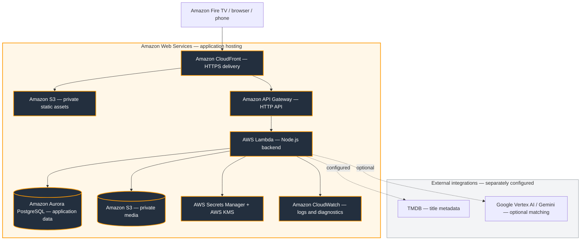
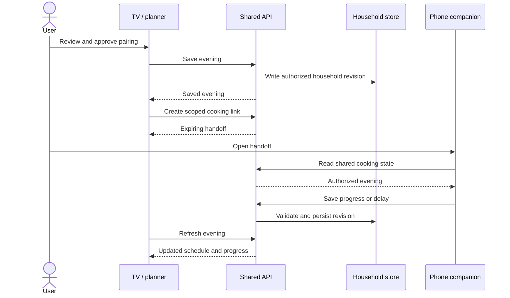

# AWS architecture

Crave Frame is hosted on **Amazon Web Services**, with an Amazon Fire TV experience and browser/phone companions. The AWS application architecture is shown first below. The full CDK design and the existing deployed stack can differ; these diagrams are not a fresh audit of account resources.

[AWS deployment, migrations and rollback](AWS-DEPLOYMENT.md)

## AWS runtime and trust boundaries

The full CDK design includes RDS Proxy, WAF and multi-AZ networking. Existing-stack tooling also supports a separately configured database authentication path. The current account is not assumed to match that full topology. Review deployment outputs and configuration before changing infrastructure.

Static assets pass through CloudFront. Private media is served through application authorization. Secrets are retrieved at runtime, not embedded in frontend bundles. Household revisions detect conflicting writes; client capabilities do not replace server authorization.

## Amazon service responsibilities

| Service | Role in Crave Frame |
| --- | --- |
| **Amazon CloudFront** | Public HTTPS entry point and static/API routing |
| **Amazon S3** | Private static releases and a separate private media store |
| **Amazon API Gateway** | HTTP API entry point for backend requests |
| **AWS Lambda** | Node.js API, authorization and planning logic |
| **Amazon Aurora PostgreSQL** | Durable household, evening and sharing data |
| **AWS Secrets Manager / AWS KMS** | Runtime secret storage and encryption |
| **Amazon CloudWatch** | Runtime logs and deployment diagnostics |
| **AWS CloudFormation / AWS CDK** | Infrastructure definition and deployment tooling |
| **Amazon RDS Proxy / AWS WAF** | Included in the full CDK design; verify presence in the existing deployment |

Amazon Fire TV is the intended living-room client. TMDB and Google Vertex AI/Gemini are external integrations, not Amazon services. The AI provider has not been migrated to Amazon Bedrock.

## Evening and phone handoff

Synchronization uses requests and polling, not WebSocket delivery. Latest local repairs serialize reads and reject obsolete responses around writes and reconnection; those repairs are included in the 22 October source update. See the dated [friction log](FRICTION-LOG.md) for verification boundaries.

## Retained Cloudflare and local runtime reference

The main TV experience is authored in tv/App.tsx and tv/src. Expo exports a React Native Web bundle under /tv/. The browser planner and phone companion are separate product surfaces, sharing the same Worker API and household data. The native Android wrapper uses the same React Native source and an HTTPS backend.

~~~mermaid
flowchart TB
  subgraph Devices
    Silk[Fire TV / Silk: /tv/]
    Native[Native Android / Fire OS]
    Web[Browser planner: /app/]
    Phone[Phone companion]
  end
  subgraph Backend
    Router[server/worker.js]
    Auth[Household / share / parent authorization]
    Plan[product planning and recipes]
    Match[server/ai.js]
    Quality[server/pairing-quality.js]
    Catalog[server/catalog.js]
  end
  Silk --> Router
  Native --> Router
  Web --> Router
  Phone --> Router
  Router --> Auth
  Auth --> Plan
  Auth --> Match
  Match --> Quality
  Match --> Catalog
  Catalog --> TMDB[TMDB]
  Match --> Vertex[server/vertex.js: Gemini]
  Auth --> Store[(D1 / local SQLite)]
  Router --> Media[(R2 media)]
~~~

## Matching request sequence

~~~mermaid
sequenceDiagram
  actor User
  participant UI as TV / web UI
  participant API as Worker
  participant Rules as Candidate builder
  participant Model as Gemini
  participant DB as Household store
  User->>UI: Pick a title and preferences
  UI->>API: POST recommendations
  API->>DB: Read household / matching cache
  alt Valid cached result
    API-->>UI: Previous matching result
  else Fresh result needed
    API->>Rules: Apply hard constraints and recent exclusions
    Rules-->>API: Allowed recipe-title IDs
    API->>Model: Context and eligible choices
    Model-->>API: Proposed candidates and explanations
    API->>API: Validate IDs and synopsis quotes; diversify finalists
    API->>DB: Cache result and record recent choices
    API-->>UI: Explained finalists or explicit unavailable state
  end
  User->>UI: Review ingredients and approve
  UI->>API: Save evening
  API->>DB: Persist approved plan
~~~

A planning request selects candidate dinners and reviews proposed story-food links in a separate model call. The earlier speculative title-context step has been removed. Conversational planning requests may also parse natural-language preferences. These are distinct model calls; quota counts user AI actions rather than tokens or individual calls.

## Persistence model

~~~mermaid
erDiagram
  HOUSEHOLDS ||--o{ SHARES : owns
  HOUSEHOLDS ||--o{ ROOMS : owns
  HOUSEHOLDS ||--o{ COLLECTIONS : owns
  HOUSEHOLDS ||--o| PARENT_CONTROLS : configures
  HOUSEHOLDS {
    text id PK
    text data
    integer revision
    text updated
  }
  SHARES {
    text id PK
    text household
    text night
    integer expires
  }
  ROOMS {
    text id PK
    text household
    text data
    integer revision
    integer expires
  }
  COLLECTIONS {
    text id PK
    text household
    text data
    integer revision
  }
  PARENT_CONTROLS {
    text household PK
    text pinHash
    text salt
    integer lockedUntil
  }
~~~

Relationships above are logical application relationships, not a claim that all are enforced as SQL foreign keys. Household JSON holds preferences, evenings, pantry, titles, explicit feedback memory, and recent pairing history. Revision numbers support conflict handling. Additional tables hold AI action counters and encrypted integration settings. See web/db/schema.ts and web/drizzle for authoritative columns and migrations.

## Boundaries and important files

| Responsibility | Source |
| --- | --- |
| HTTP routes, request validation, saved evenings | web/server/worker.js |
| AI preferences, eligibility, prompts and quotas | web/server/ai.js |
| Evidence text matching and finalist diversity | web/server/pairing-quality.js |
| Vertex token exchange and structured generation | web/server/vertex.js |
| TMDB lookup and regional availability | web/server/catalog.js |
| Recipe quantities and cooking steps | web/product/engine.js |
| Delay, rescue and order-out schedule logic | web/product/planning.js |
| Household and cooking companion access | web/server/companion.js and worker.js |
| Shared planning and media | web/server/social.js |
| TV navigation and orchestration | tv/App.tsx |
| Cancelable client requests | tv/src/api.ts |
| Animated matching presentation | tv/src/MatchingStage.tsx |

## Deployment and build

Root build exports tv/web-export, copies it into web/product/tv, then assembles web/dist/client and web/dist/server/index.js. The Worker expects DB, ASSETS, and production MEDIA bindings. Checked-in web/.openai/hosting.json identifies the existing Sites deployment; a new operator must use their own project/bindings before deploying. The repository is not automatically deployed to the live site by GitHub Actions.

The local Node server runs the same request handler with a SQLite adapter and static-file adapter. It does not emulate all Cloudflare services. No native SDKs, local databases, cloud credentials, generated exports, or prior development history are included in the repository.
