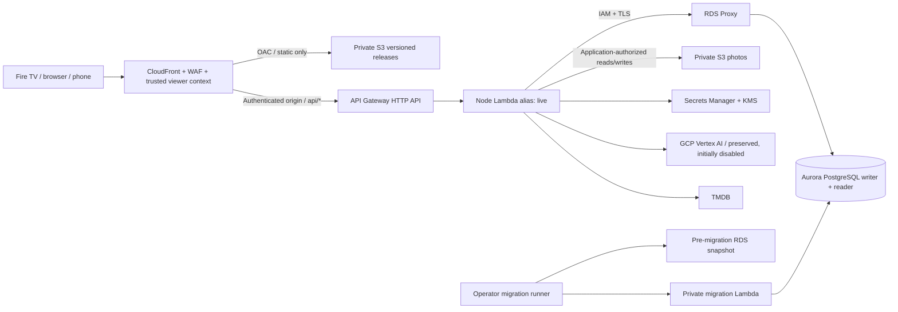

# CraveFrameAmazon2026: parallel AWS deployment

This is a separate AWS environment. Nothing in these commands deploys to, replaces,
imports data from, or changes DNS for the existing Cloudflare/Sites deployment.
Cloudflare remains the user-facing rollback until all acceptance checks pass.

## Before deployment

The feature branch includes the previously uncommitted UX and security corrections.
The supplied baseline was `a2fbade`; this branch is a continuation, not a reset.
Use a reviewed branch commit for the production release marker.

**Migration decision:** start with an empty AWS database and empty media bucket.
Existing D1/R2 data is NOT copied. Existing Cloudflare household keys, private links
and saved evenings will not work on AWS. Local storage is origin-specific. Do not
silently redirect existing users to the new origin. Data transfer is a separate
planned maintenance operation described below.

**Blast radius:** one new stack, new VPC, database, proxy, buckets, keys, secrets,
functions, distribution, Web ACL, alarms, and logs in the selected AWS account.
CDK bootstrap may create/update the account's regional CDK deployment resources.
Review bootstrap IAM permissions with the account owner. No Cloudflare resources,
existing account workloads, DNS records or GCP projects are modified by this stack.

**Region:** initial stack supports `us-east-1` only because CloudFront WAF requires
that control-plane region. A different database region requires splitting the WAF
stack first. Account IDs are discovered at deployment, never checked into source.

## Services and estimated monthly cost

Planning estimate as of 2026-10-12, USD, us-east-1, 730 hours, low traffic (100,000
API calls, 10 GB internet delivery, 10 GB database data, 5 GB media), no free-tier
credits. This is a budget estimate, not a guaranteed quote.

| Service/configuration | Estimate |
| --- | --- |
| Aurora PostgreSQL Serverless v2 writer + reader, each 0.5–4 ACU | $87.60 at minimum; $700.80 if both sustain 4 ACU |
| RDS Proxy, one default endpoint | Budget $15–90 at light use; confirm current regional minimum/capacity billing |
| Two NAT gateways for outbound Vertex/TMDB access | About $65.70 hourly base, plus processed data |
| Two public IPv4 addresses | About $7.30 |
| CloudFront, CloudFront Function, API Gateway HTTP API, Lambda | Budget $5–20 at light traffic |
| Private static/media S3, Aurora storage/I/O/backup | Budget $5–20 |
| Secrets Manager (four secrets), KMS key, CloudWatch logs/alarms, WAF | Budget $10–25 |

**Plan for approximately $200–320/month at light load.** Sustained high database
capacity can take this beyond $900/month. Vertex AI, taxes, domain registration,
support, account-specific pricing, migration snapshot retention, and unexpected
traffic are additional. Two AZs and two NAT gateways intentionally cost more than
a single-AZ hackathon demo. Do not deploy assuming scale-to-zero or a free tier.

Sources: [Aurora pricing](https://aws.amazon.com/rds/aurora/pricing/),
[RDS Proxy pricing](https://aws.amazon.com/rds/proxy/pricing/),
[VPC pricing](https://aws.amazon.com/vpc/pricing/). Recalculate in the AWS Pricing
Calculator with the account's actual region and expected traffic before deployment.

## Architecture



`/` and `/app/` serve the browser planner. `/tv/` serves the TV/phone app, including
`?cook=` handoffs. `/api/*` goes to Lambda. AWS never calls `ASSETS.fetch` or the
Worker's document-serving entrypoint; it imports the shared API function only.

S3 static access uses CloudFront OAC. Media has no CloudFront behavior, no public
ACL, and no presigned URLs. Existing application photo-reference authorization is
preserved. Deleting media removes the object (media versioning is deliberately off
to avoid leaving privately deleted photographs as old versions).

The DB compatibility adapter handles positional parameters, INSERT OR IGNORE,
photo JSON queries, and PostgreSQL upsert qualification. JSON stays text. Expiry
timestamps and quotas use bigint, mapped to safe JS integers. Row counts preserve
optimistic revision conflict detection and household-scoped queries.

## Secrets and trust boundaries

Populate the `RuntimeSecretArn` JSON **in Secrets Manager**, retaining all keys:
`GCP_SERVICE_ACCOUNT_JSON` (a JSON string), `GCP_PROJECT_ID`, `GCP_MODEL`,
`TMDB_ACCESS_TOKEN`, `INTEGRATION_ENCRYPTION_KEY` (base64 32-byte AES key).
Use the console or your organization's secure secret provisioning workflow. Do
not put values in commands, logs, source, CDK context, or Lambda environment.

The runtime gets only runtime/edge secret reads, IAM connection to `crave_app` via
the proxy, and photo-prefix S3 access. It cannot read database passwords or migrate
the schema. The proxy has its separate app-password secret; the migration role
reads only admin/app DB secrets and verifies backup metadata. Deployment operators
need permission to resolve the edge secret for CloudFront's origin header. Thus
runtime credentials are protected from clients, not from an AWS administrator.

CloudFront overwrites the viewer IP header using `event.viewer.ip`, strips forged
forwarding/Cloudflare headers, and adds an origin authentication secret. Lambda
checks that secret before trusting the edge-generated IP. Direct execute-api calls
fail closed. API Gateway's `sourceIp` is a CloudFront edge address in this setup,
so it is deliberately NOT used to group households. WAF separately limits actual
viewer IPs. Per-household creation counters store daily hashes, not raw IPs.

Keep CloudFront distribution read permissions restricted: origin custom headers
are visible to authorized distribution administrators. Secret rotation must
update CloudFront and Lambda together; allow the runtime cache's 60 seconds to
expire. Do not rotate the edge secret independently during active traffic.

## Build and local verification (PowerShell)

```powershell
# Repository root
npm run check:secrets
npm test
npm run build
Set-Location aws
npm ci
$env:CRAVE_RELEASE_VERSION='REVIEWED-COMMIT-AND-RELEASE-NAME'
npm run build
npm run synth
npm test
```

AWS build output is ignored under `aws/.release`. The RDS public CA bundle is
downloaded over HTTPS from AWS during the build, never a private key. Lambda checks
server certificates and uses fresh IAM proxy authentication when connecting.
Generated CloudFormation files, outputs, account metadata and contexts are ignored.
Archive release artifacts in a private deployment artifact store, not in Git.

## Deploy only after reviewing the pre-deployment report

Install AWS CLI v2, sign in with an authorized profile, and set it locally:

```powershell
$env:AWS_PROFILE='YOUR-LOCAL-PROFILE'
$env:AWS_REGION='us-east-1'
$env:CDK_DEFAULT_REGION='us-east-1'
# Bootstrap only if this account/region is not already bootstrapped.
npx cdk bootstrap
npm run diff
npm run deploy
npm run migrate -- plan
npm run migrate -- apply 001_initial.sql
# Populate runtime settings in Secrets Manager using RuntimeSecretArn.
npm run smoke
```

Initial deployment readiness is expected to be 503 until migrations finish.
`/api/health` reveals only status and deployment version; it checks DB connectivity
and the schema ledger. It is not a probe of Vertex/TMDB availability. Configure an
operator notification destination for the CloudWatch alarms; the stack creates
alarms but does not invent an email subscription or page anyone.

Post-deploy smoke verifies documents, assets, error headers, version consistency,
direct-origin denial, private media, two household keys, persistence, sharing,
phone progress, QR route, revocation, and media cleanup. It creates two empty test
households, cleans up their evening/collection/media, and prints no tokens or IPs.

The separate-network test still requires two real egress IPs: run household creation
from a home connection and a mobile connection, then inspect the daily hashed
counter rows privately through the DB operator. Each must have a different key.
Do not weaken trust by injecting X-Forwarded-For to simulate this live check.

## Migrations, staged rollout and restore

The SQL runner uses an advisory lock, checksummed `schema_migrations` ledger, and
a transaction for the pending batch. `plan` does not create the ledger or modify
data. `apply TARGET.sql` applies up to a known target; older or unknown targets are
rejected. Reapplying a committed migration with edited SQL is rejected.

Before **every apply**, the external runner creates a cluster snapshot and waits
until available. The migration Lambda independently checks cluster ownership,
availability and age (under one hour). A failed snapshot means no migrations run.
The wait is outside Lambda so it can outlive Lambda's execution timeout.

Use expand/contract migrations: add compatible schema, apply and verify it while
the old runtime remains live, then deploy the new runtime; remove old columns only
in a later release after the rollback window. For initial setup, deploying the
empty application before migrating is expected. Future breaking migrations require
a maintenance window and must not be included in a routine application rollout.

Restore procedure (test on the parallel environment before any cutover):

1. Stop AWS writes (set backend reserved concurrency to 0). Keep Cloudflare live.
2. Choose the pre-migration snapshot or a point within the 14-day PITR window.
3. Use RDS **Restore snapshot** / **Restore to point in time** into a **new** cluster
   in the same isolated DB subnets/security group, with encryption and deletion
   protection. Create a serverless writer; wait for availability.
4. Verify ledger checksums, household counts, sample saved plans and media refs on
   the restored cluster. Do not run migrations blindly. Media is not restored by
   an RDS snapshot; reconcile dangling refs and preserve existing private objects.
5. Using RDS **Modify proxy target group**, remove the failed cluster target and
   register the restored cluster; wait for healthy targets. Confirm the app role's
   password matches the proxy secret. Update the IaC to adopt the restored cluster
   before future deploys; do not let CloudFormation recreate the failed topology.
6. Restore backend concurrency and run smoke. Retain the failed cluster read-only
   until data reconciliation is complete. Snapshot restore can lose writes after
   the snapshot; record the loss window and do not imply zero-loss rollback.

## Application rollback

Keep the prior code commit, `.release` bundle, version marker, and Lambda version.
Published Lambda versions and static prefixes are retained. The `live` alias is
the API integration target. An emergency backend rollback can use AWS CLI:

```powershell
aws lambda update-alias --function-name YOUR-BACKEND --name live --function-version PREVIOUS-VERSION
```

For a complete rollback, deploy the previously archived release bundle and matching
source with its original release identifier; this repoints CloudFront's static
origin path and the Lambda alias together through CDK. Invalidate `/*`, wait for
CloudFront deployment, run smoke, and reconcile any emergency alias drift with
CDK before the next release. Do not rebuild old source using new dependencies.
Do not delete DB/media during rollback. Avoid `cdk destroy`: retained storage and
deletion protection are intentional, and residual resources still incur charges.

If AWS verification fails, leave public links on Cloudflare. Moving people back
from AWS to Cloudflare does not transfer AWS-only data. Keep the AWS data available
for reconciliation. Cloudflare remains separate; no automatic bidirectional sync
or database cutover is implemented.

## Optional later D1/R2 data copy (not performed)

Agree on downtime, ownership and retention first. Quiesce writes, back up D1/R2,
export tables to encrypted operator storage, and transform integer/JSON values to
the checked PostgreSQL schema. Preserve household IDs, revision numbers and the
original integration encryption key if retaining encrypted integration records.
Copy only referenced R2 photographs to the private media bucket; validate counts
and checksums. Revoke/expire shares that should not cross environments. Origin-local
client credentials require an explicit secure handoff; never collect household
keys via public forms or logs. This branch intentionally provides no blind SQL
dump importer or automatic export of private production data.

## Fire TV APK and device acceptance

After `outputs.json` exists and AWS smoke passes, from repository root:

```powershell
$deployment=(Get-Content aws/outputs.json -Raw | ConvertFrom-Json).CraveFrameAmazon2026
$env:EXPO_PUBLIC_API_ORIGIN=$deployment.Origin
./tv/scripts/build-tv.ps1 -ApiOrigin $deployment.Origin -GradleCache 'D:\cf-gradle'
```

This reuses the validated HTTPS origin parameter; the origin is public configuration.
The web export must be built without a stale `EXPO_PUBLIC_API_ORIGIN` so browsers
use their own CloudFront origin. Do not change the existing native fallback until
AWS verification succeeds. Use secure release-signing configuration for release
builds; no keystore is committed. This branch does not certify an APK has been built.

Run the eight-step remote/phone walkthrough in FIRE-TV-INSTALL.md against AWS.
Record device model/OS, cold launch, every remote action, QR scan, delay, phone
progress, app resume, network recovery and revocation. Test from two networks and
after Lambda cold starts. Screenshots and test names alone are not device evidence.

## Unresolved risks / cutover blockers

- No AWS account/profile or deployment has been verified for this branch yet.
- No live CloudFront headers, IAM denial, RDS failover/restore, WAF identity test,
  physical Fire TV build/navigation or cross-device sync has passed yet.
- HTTP API has a 30-second integration maximum; Lambda is bounded at 28 seconds.
  Current AWS release is catalog-only, matching the existing live configuration.
  Vertex code/secret support remains, but enabling live multi-call AI requires an
  asynchronous jobs/polling path or verified request budgeting before production.
  Broad streaming-provider filtering can also exceed the request budget and must
  pass latency testing before cutover. Do not claim AI parity is verified.
- CloudFront-generated errors outside origin processing may need additional edge
  response handling if live smoke finds missing headers. The default CloudFront
  certificate controls its TLS policy; use a custom domain/certificate if policy
  mandates a TLS 1.2-only viewer minimum.
- Aurora engine availability, service quotas, stack IAM and alarm notification
  delivery require account-specific validation. Existing TV advisories remain.
- App rate limits are per public egress IP; large shared networks may hit the same
  creation quota. AI/API cost caps are not absolute AWS billing limits.
- Recipe trials and artwork rights remain product release checks, separate from
  this infrastructure migration.
